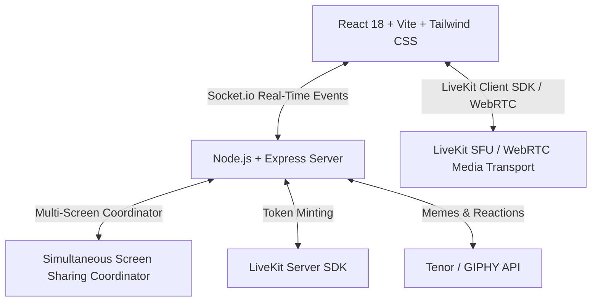

# TradeMeet – Live Trading Community

**TradeMeet** is a modern, real-time trading collaboration platform engineered for active traders, analysts, and trading communities worldwide. Traders can join or create live trading floors using a server number (e.g. Server 1, Server 7, GOLD), communicate via low-latency voice and video, **share their screens simultaneously (all participants can share at the same time)**, and communicate through **rich real-time text message chat with trading GIFs, emojis, and image sharing**.

---

## 🚀 Key Features

### 1. Home Page & Dynamic Room Joining
- **Dark Trading Terminal Theme**: Inspired by Discord and trading terminals (`#0B0F19`, `#151B2B`, `#00C896`, `#FF4B55`) with animated candlestick chart waves in the background.
- **Server Number System**: Enter any server number (e.g., `1`, `7`, `GOLD`, `CRYPTO`).
- **Automatic Multi-User Synchronization**: Two or more traders entering Server `1` automatically join the exact same live trading floor.
- **Strict Room Isolation**: Users in Server `1` never see, hear, or receive messages from Server `2`.
- **Live Server Status Indicator**: Real-time debounce check showing whether the server is active (`🟢 3 Traders Live`) or ready to start (`⚪ Ready to Start`).
- **Active Server Directory**: Browse running trading floors with one-click entry.

### 2. Simultaneous Multi-Screen Sharing (All Can Share At A Time)
- **Multi-Screen Sharing Grid**: **All participants can share their screens at the exact same time.**
- **Dynamic Multi-Screen Matrix**:
  - **1 Screen**: Full high-resolution viewer.
  - **2 Screens**: 50/50 side-by-side comparison.
  - **3–4 Screens**: 2x2 multi-screen matrix.
  - **5+ Screens**: Responsive multi-screen grid.
- **Spotlight Mode**: Click any shared screen to spotlight it in center stage while keeping thumbnail filmstrips of other screens along the bottom.
- **Individual Fullscreen**: Click the fullscreen button on any individual shared screen tile to focus completely on that presenter's view.
- **Presenter Attribution**: Clear badges identifying who is sharing each screen (e.g. `ApexTrader's Screen`, `CryptoWhale's Screen`).

### 3. Real-Time Text Message Chat, GIFs & Images
- **Instant Messaging**: Real-time WebSocket chat stream with sender names, avatar colors, role badges, and timestamps.
- **Searchable Trading GIF Picker**: Integrated Tenor/GIPHY search API plus a curated library of high-impact trading memes (Bull 🐂, Bear 🐻, Moon 🚀, Profit 💰, HODL 💎🙌).
- **Direct GIF & Image URL**: Paste any direct media URL or upload local images directly into the chat stream.
- **Trading Emoji Bar**: Quick reactions (`🚀`, `📈`, `📉`, `💎`, `🔥`, `🐂`, `🐻`, `💰`).
- **Auto-Scroll & Message History**: Automatically keeps conversation in focus as new messages arrive.

### 4. Scalable Voice & Video Meetings (25+ Traders)
- **LiveKit SFU & WebRTC Architecture**: Designed for 25+ concurrent audio and video feeds without CPU exhaustion.
- **Microphone Controls & Active Speaker Detection**: Web Audio API (`AudioContext` Analyser) calculates real-time RMS voice levels to glow speaker borders and animate volume waves.
- **Camera Feeds & Dynamic Grid**: Automatically reconfigures grid layout for 1, 2, 4, 6, 9, 16, and 25+ participants.
- **Self-View Minimization**: Option to hide self-view for maximum screen sharing and chat visibility.
- **Hardware Device Selector**: Pick cameras, microphones, and test mic input levels in real-time.

### 5. User Roles & Host Moderation
- **Host**: Room creator/first trader in room. Can mute all participants, lock room against new entrants, toggle screen sharing permissions, or end the meeting for all.
- **Moderator**: Can mute individual noisy mics and remove disruptive users.
- **Participant**: Talk, video, text chat, GIFs, and share screens. No registration needed.

---

## 🛠️ Architecture & Tech Stack



- **Frontend**: React 18, TypeScript, Vite, Tailwind CSS, Lucide React, Framer Motion.
- **Backend**: Node.js, Express, Socket.io, `livekit-server-sdk`.
- **Media Engine**: WebRTC with LiveKit SFU client & token generator.

---

## 🚦 Getting Started

### 1. Install Dependencies
```bash
npm install
```

### 2. Run in Development Mode
Starts both the Express/Socket.io backend on port 5000 and the Vite frontend on port 3000:
```bash
npm run dev
```
Open **[http://localhost:3000](http://localhost:3000)** in your browser.

### 3. Build & Run in Production
```bash
npm run build
npm start
```

### 4. Run the 32+ Participant & Multi-Screen Sharing Simulation Test
```bash
npm run test:simulate
```
Or run the complete automated suite:
```bash
npx tsx scripts/run-all-tests.ts
```
